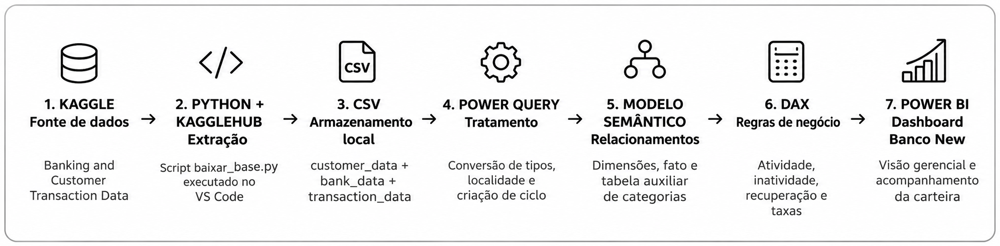
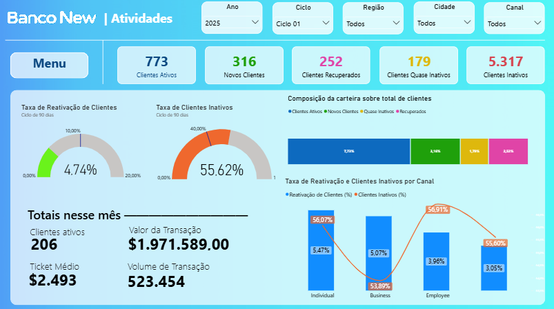

# Atividade de Clientes Banco New | Business Intelligence

Projeto de portfólio desenvolvido com o objetivo de explorar a integração entre diferentes tecnologias e o fluxo de dados, desde a extração automatizada de informações do Kaggle utilizando Python e KaggleHub, passando pelo tratamento, transformação e modelagem dos dados no Power Query, até a construção de indicadores em DAX.

O Power BI representa a etapa final desse processo, consolidando os conhecimentos adquiridos em um dashboard interativo para análise de atividade, inatividade e recuperação de clientes de um banco fictício.

> **Aviso:** Banco New é uma marca fictícia. O conjunto de dados é sintético e histórico, utilizado exclusivamente para aprendizagem e demonstração de competências em Business Intelligence. Os indicadores não representam resultados de uma instituição financeira real.

## Objetivo

Construir uma visão gerencial interativa da carteira de clientes, monitorando atividade, risco de inatividade e reativação por período, região, cidade e perfil.

## Tecnologias

- **Kaggle:** fonte do conjunto de dados sintéticos.
- **Python + KaggleHub:** download automatizado dos arquivos.
- **CSV:** arquivos de origem utilizados no relatório.
- **Power Query (M):** importação, conversão de tipos e criação de ciclos trimestrais.
- **Power BI + DAX:** modelagem, medidas e visualizações.

## Fonte dos dados

[Banking and Customer Transaction Data — Kaggle, por Yogesh Tekawade](https://www.kaggle.com/datasets/yogeshtekawade/banking-and-customer-transaction-data)

Arquivos utilizados: `customer_data.csv`, `bank_data.csv` e `transaction_data.csv`.


## Extração automatizada com Python

Para obtenção dos dados bancários, foi desenvolvido um script Python no Visual Studio Code, utilizando a biblioteca **KaggleHub** para automatizar o download do dataset disponibilizado no Kaggle.

### Etapas do processo

1. **Configuração do ambiente:** utilização do Python no VS Code e instalação das bibliotecas KaggleHub e Pandas.
2. **Conexão com o Kaggle:** identificação do dataset por meio de seu endereço na plataforma.
3. **Extração automatizada:** execução do método `kagglehub.dataset_download()` para baixar os arquivos.
4. **Armazenamento local:** organização dos dados na pasta `BankAnalytics/dados`.
5. **Validação da extração:** identificação e listagem dos arquivos baixados para confirmar a conclusão do processo.

### Script de extração

```python
import kagglehub
from pathlib import Path

# Definir pasta de destino
pasta_destino = Path(__file__).resolve().parent / "dados"

# Baixar dataset
caminho = kagglehub.dataset_download(
    "yogeshtekawade/banking-and-customer-transaction-data",
    output_dir=str(pasta_destino)
)

# Listar arquivos baixados
arquivos = sorted(
    arquivo for arquivo in Path(caminho).rglob("*")
    if arquivo.is_file()
)

print("BASE BANCÁRIA BAIXADA")
print(f"Total de arquivos: {len(arquivos)}")

for arquivo in arquivos:
    print(f"- {arquivo.name}")
```

### Arquivos obtidos

- `customer_data.csv` — Cadastro e características dos clientes.
- `bank_data.csv` — Informações das agências bancárias.
- `transaction_data.csv` — Histórico de transações financeiras.

### Benefícios da automação

A utilização do Python permitiu:

- Automatizar a obtenção dos dados.
- Reduzir a necessidade de downloads manuais.
- Organizar os arquivos em um diretório padronizado.
- Facilitar a reprodução do processo de extração.
- Integrar programação Python ao fluxo de Business Intelligence.

**Observação:** nesta etapa, o Python foi utilizado exclusivamente para extração e armazenamento dos dados. O tratamento, a transformação e a modelagem foram realizados posteriormente no Power Query e no Power BI.


## Fluxo dos dados





## Modelo

- `dim_bank` → `dim_customer` pela coluna `Branch_ID` (1:*).
- `dim_customer` → `fat_transaction` pela coluna `Customer_ID` (1:*).
- `dim_status_cliente`: categorias auxiliares de composição da carteira.

A estrutura principal é um modelo em floco de neve (*snowflake*).

## Regras de análise

- **Ciclos:** 4 por ano, correspondentes aos trimestres (Ciclo 01: jan–mar; Ciclo 02: abr–jun; Ciclo 03: jul–set; Ciclo 04: out–dez).
- **Inativos:** clientes com mais de 90 dias sem transações na data de referência.
- **Quase inativos:** faixa de alerta definida no modelo; consultar a versão final das medidas no PBIX.
- **Novos:** primeira transação no histórico dentro da janela definida.
- **Elegíveis à recuperação:** clientes já inativos no início da janela de acompanhamento.
- **Recuperados:** clientes elegíveis que voltaram a transacionar durante a janela.
- **Taxa de reativação:** recuperados elegíveis ÷ elegíveis no início da janela.

As janelas utilizadas nos indicadores devem ser verificadas nas medidas DAX do arquivo PBIX, pois há indicadores mensais, trimestrais e de últimos 60/90 dias.

## Dashboard

Visões construídas:

- KPIs de clientes ativos, novos, recuperados, quase inativos e inativos.
- Medidores de taxa de reativação e taxa de inatividade com metas ilustrativas.
- Composição e segmentação da carteira.
- Análise por região, cidade e perfil/canal.
- Resumo da movimentação no último mês registrado.



## Limitações

- Dados sintéticos e históricos, sem atualização bancária em tempo real.
- Identificação de clientes novos baseada na primeira transação observada, não necessariamente na abertura de conta.
- Volumes transacionados não representam receita ou lucro bancário.
- As categorias de comportamento podem se sobrepor nos cartões; uma composição de 100% exige classificação exclusiva.

---

## Download do Power BI

O dashboard completo está disponível para exploração no Power BI Desktop.

📊 **[Baixar Dashboard Banco New (.pbix)](./Banco%20New.pbix)**

